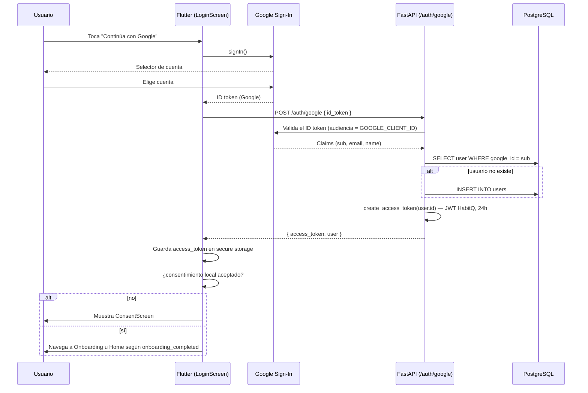
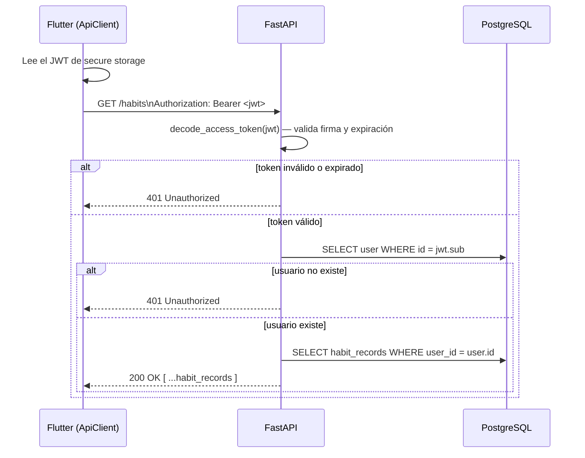
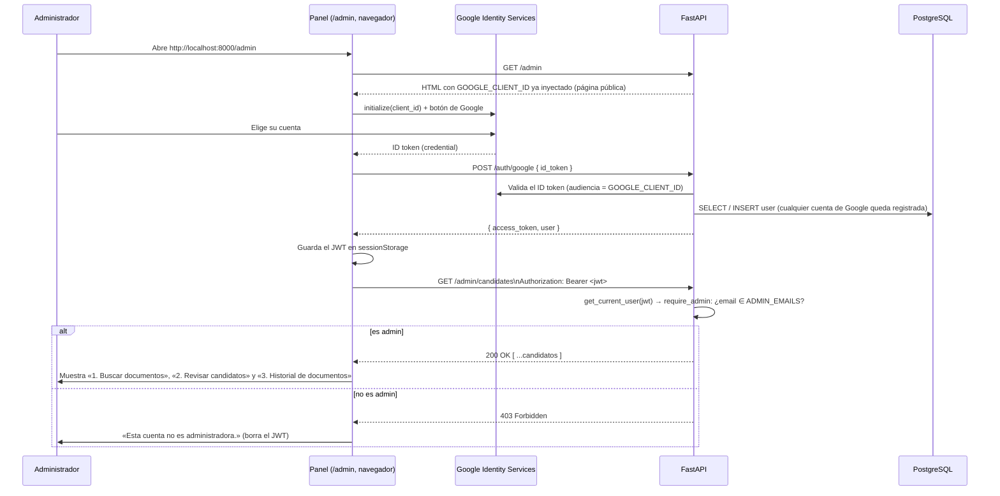

# Secuencias de autenticación

## Login con Google (implementado)

## Llamada autenticada típica (ej. GET /habits)

Este segundo diagrama es el flujo que sigue **todo** endpoint privado (`get_current_user` en `backend/app/api/deps.py`) — nunca se confía en un `user_id` enviado por el cliente (plan, sección 10).

## Login en el panel de administración (navegador)

Reutiliza el mismo `POST /auth/google` y el mismo JWT que la app móvil. Lo único nuevo es quién obtiene el ID token (Google Identity Services en el navegador) y la comprobación `require_admin`.

Puntos que conviene recordar:

- **Origen autorizado:** el cliente OAuth **Web** debe tener `http://localhost` y `http://localhost:8000` en *Authorized JavaScript origins*. Hay que abrir el panel con esa dirección exacta (no `127.0.0.1`).
- **Todo correo queda registrado:** iniciar sesión con una cuenta que no es admin igualmente crea su fila en `users`; el 403 llega después, en el primer endpoint `/admin`.
- **`ADMIN_EMAILS`** se compara sin distinguir mayúsculas y se lee al arrancar el backend: tras cambiarlo hay que reiniciarlo.
- **Alternativa sin Google:** el panel acepta pegar un JWT ya emitido (sección «Alternativa» de la pantalla de login).
