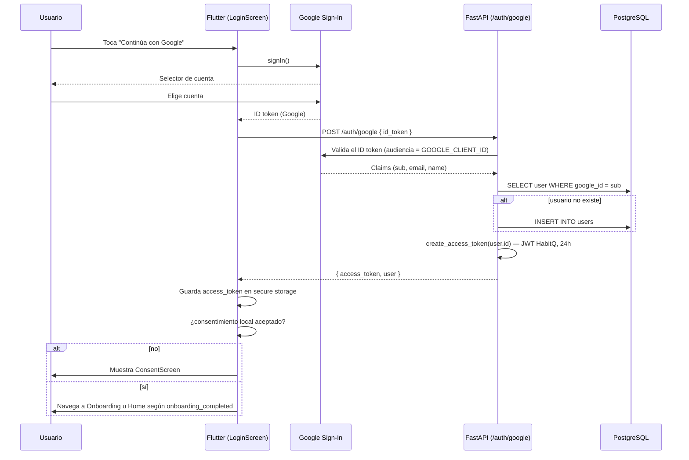
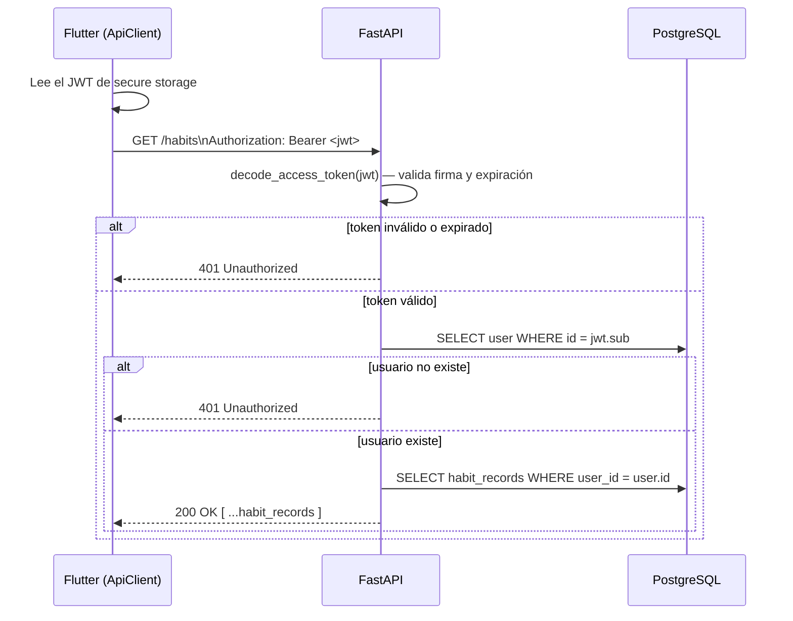

# Secuencias de autenticación

## Login con Google (implementado)

## Llamada autenticada típica (ej. GET /habits)

Este segundo diagrama es el flujo que sigue **todo** endpoint privado (`get_current_user` en `backend/app/api/deps.py`) — nunca se confía en un `user_id` enviado por el cliente (plan, sección 10).
