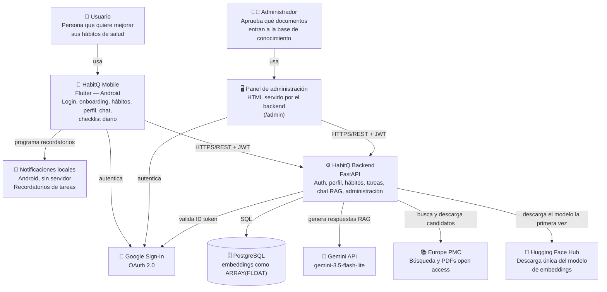

# Diagrama de contexto (C4 — Nivel 1)

Vista de alto nivel: quién usa HabitQ y con qué sistemas externos interactúa. Renderiza directamente en GitHub (Mermaid).

> Usamos un flowchart estándar (no la sintaxis `C4Context` de Mermaid) para máxima compatibilidad de renderizado entre GitHub, VS Code y otros visores.

## Estado de cada relación

| Relación | Estado |
|---|---|
| Usuario → Mobile | ✅ Implementado |
| Mobile → Google (OAuth) | ✅ Implementado |
| Mobile → Backend (REST + JWT) | ✅ Implementado (auth, perfil, hábitos, tareas diarias, chat con referencias, historial) |
| Mobile → Notificaciones locales de Android | ✅ Implementado (recordatorios de tareas con alarmas exactas, ventana de 7 días; D-25). No pasa por el backend |
| Administrador → Panel → Backend | ✅ Implementado (`/admin`; requiere que el correo esté en `ADMIN_EMAILS`) |
| Panel → Google (OAuth) | ✅ Implementado (Google Identity Services en el navegador; exige registrar `http://localhost` y `http://localhost:8000` como orígenes de JavaScript del cliente Web) |
| Backend → Google (validar ID token) | ✅ Implementado |
| Backend → PostgreSQL | ✅ Implementado (11 tablas, migraciones `0001`–`0009`) |
| Backend → Gemini | ✅ Implementado (`POST /chat`, modelo fijo `gemini-3.5-flash-lite` — D-26; retry configurado — D-16) |
| Backend → Europe PMC | ✅ Implementado (`POST /admin/discovery` y descarga de PDFs aprobados; D-17) |
| Backend → Hugging Face Hub | ✅ Solo la primera vez en cada máquina: después el modelo se carga desde disco (D-20) |
| pgvector (embeddings) | ❌ No usado — no disponible en el entorno de desarrollo; los embeddings se guardan como `ARRAY(FLOAT)` con similitud coseno en Python (ver `docs/decisions.md` D-12) |
