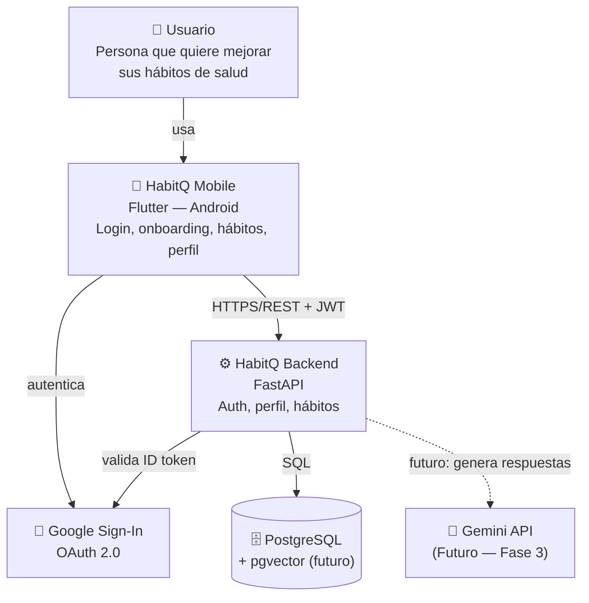

# Diagrama de contexto (C4 — Nivel 1)

Vista de alto nivel: quién usa HabitQ y con qué sistemas externos interactúa. Renderiza directamente en GitHub (Mermaid).

> Usamos un flowchart estándar (no la sintaxis `C4Context` de Mermaid) para máxima compatibilidad de renderizado entre GitHub, VS Code y otros visores.

## Estado de cada relación

| Relación | Estado |
|---|---|
| Usuario → Mobile | ✅ Implementado |
| Mobile → Google (OAuth) | ✅ Implementado |
| Mobile → Backend (REST + JWT) | ✅ Implementado (auth, perfil, hábitos) |
| Backend → Google (validar ID token) | ✅ Implementado |
| Backend → PostgreSQL | ✅ Implementado (`users`, `profiles`, `habit_records`) |
| Backend → Gemini | ❌ No implementado — Fase 3 del plan |
| pgvector (embeddings) | ❌ No implementado — Fase 3 del plan |
