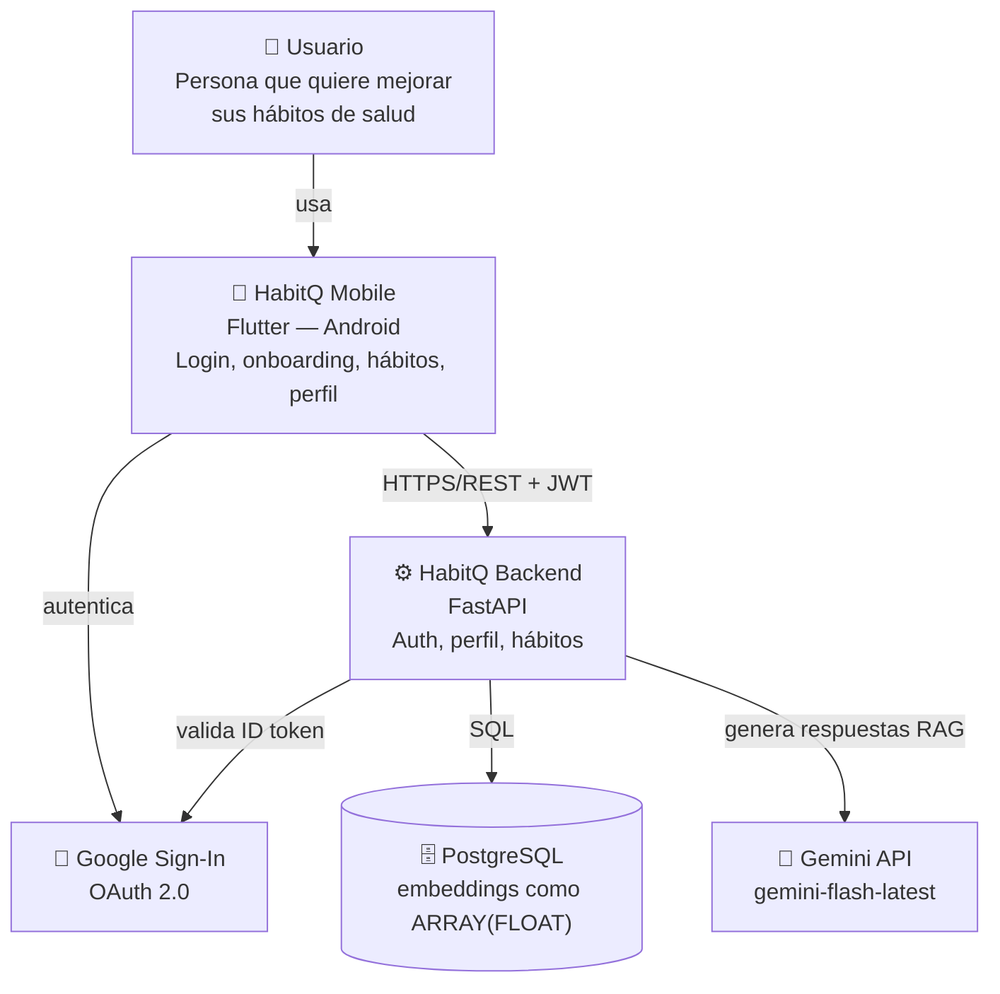

# Diagrama de contexto (C4 — Nivel 1)

Vista de alto nivel: quién usa HabitQ y con qué sistemas externos interactúa. Renderiza directamente en GitHub (Mermaid).

> Usamos un flowchart estándar (no la sintaxis `C4Context` de Mermaid) para máxima compatibilidad de renderizado entre GitHub, VS Code y otros visores.

## Estado de cada relación

| Relación | Estado |
|---|---|
| Usuario → Mobile | ✅ Implementado |
| Mobile → Google (OAuth) | ✅ Implementado |
| Mobile → Backend (REST + JWT) | ✅ Implementado (auth, perfil, hábitos, chat, historial) |
| Backend → Google (validar ID token) | ✅ Implementado |
| Backend → PostgreSQL | ✅ Implementado (`users`, `profiles`, `habit_records`, `scientific_documents`, `document_chunks`, `conversations`, `messages` — 7 tablas, migraciones `0001`–`0005`) |
| Backend → Gemini | ✅ Implementado (`POST /chat`, retry configurado — ver `docs/decisions.md` D-14/D-16) |
| pgvector (embeddings) | ❌ No usado — no disponible en el entorno de desarrollo; los embeddings se guardan como `ARRAY(FLOAT)` con similitud coseno en Python (ver `docs/decisions.md` D-12) |
