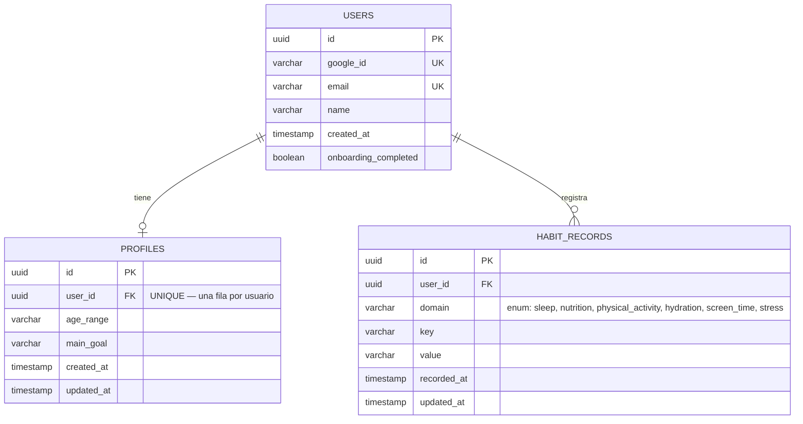
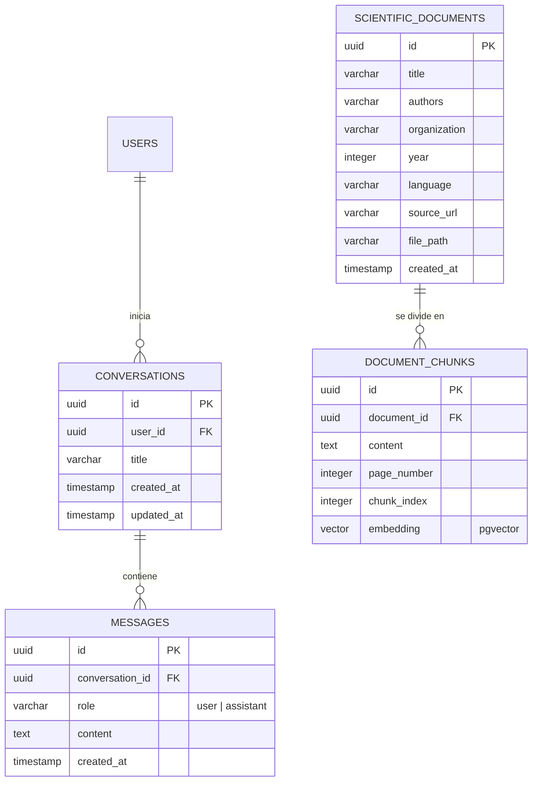

# Modelo entidad-relación

## Implementado (migraciones `0001`–`0003`)

**Notas de diseño (decisiones reales, ver [`../decisions.md`](../decisions.md)):**
- `profiles.user_id` es `UNIQUE` — decisión propia (no explícita en el plan) de que solo existe **una** fila de perfil por usuario, actualizada por `PUT /profile` (upsert).
- `habit_records` es un **log append-only**: `POST /habits` siempre crea una fila nueva; `PUT /habits/{id}` solo edita una fila existente. Por eso tiene `recorded_at` (cuándo se registró originalmente) *y* `updated_at` (última edición) por separado.
- `domain` está validado en el backend contra un enum cerrado de 6 valores (los dominios del plan, sección 2), aunque la columna en sí sea `VARCHAR` — la validación vive en `app/schemas/habit_record.py`, no en un `CHECK` de PostgreSQL.

## Planeado, no implementado (Fase 3 del plan — RAG)

Definición completa en `HABITQ_DEVELOPMENT_PLAN.md`, sección 8. Ninguna de estas 4 tablas tiene migración todavía.
