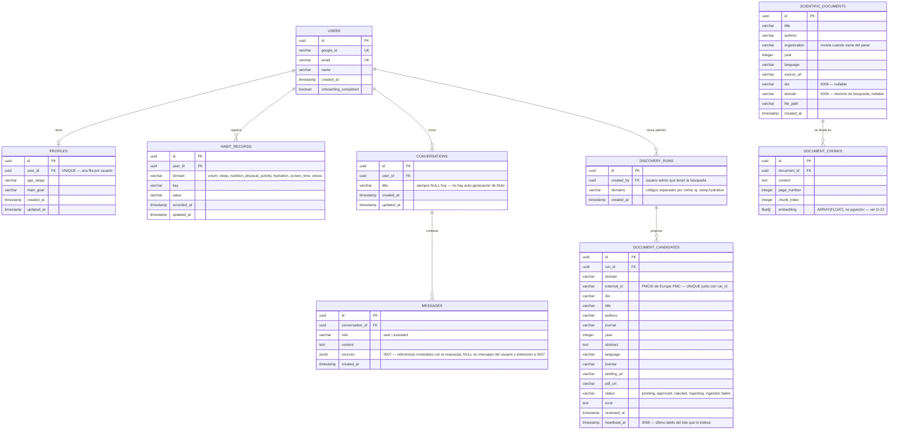

# Modelo entidad-relación

## Implementado (migraciones `0001`–`0008`)

9 tablas. Las siete primeras (`0001`–`0005`) son el modelo de datos del plan (sección 8). `discovery_runs` y `document_candidates` (`0006`) son un agregado posterior para el panel de administración (D-17); `0007` agrega `messages.sources` (D-18) y `0008` agrega `document_candidates.heartbeat_at` (D-21).

**Notas de diseño (decisiones reales, ver [`../decisions.md`](../decisions.md)):**
- `profiles.user_id` es `UNIQUE` — decisión propia (no explícita en el plan) de que solo existe **una** fila de perfil por usuario, actualizada por `PUT /profile` (upsert).
- `habit_records` es un **log append-only**: `POST /habits` siempre crea una fila nueva; `PUT /habits/{id}` solo edita una fila existente. Por eso tiene `recorded_at` (cuándo se registró originalmente) *y* `updated_at` (última edición) por separado.
- `domain` de `habit_records` está validado en el backend contra un enum cerrado de 6 valores (los dominios del plan, sección 2), aunque la columna en sí sea `VARCHAR` — la validación vive en `app/schemas/habit_record.py`, no en un `CHECK` de PostgreSQL. El `domain` de `document_candidates` / `scientific_documents` es otro catálogo, de 7 valores (agrega `substance_use`), usado solo para buscar documentos (D-17).
- `document_chunks.embedding` es `ARRAY(FLOAT)`, no `vector` de pgvector — pgvector no está disponible en el entorno de desarrollo (ver D-12 en `docs/decisions.md`). Su dimensión depende del modelo de embeddings activo (384 con `multilingual-e5-small`); al cambiar de modelo hay que reindexar (D-20).
- `messages.conversation_id` no tiene `ondelete=CASCADE` — borrar una conversación borra primero sus mensajes explícitamente (`chat_service.delete_conversation`, con un `db.flush()` intermedio, necesario porque este proyecto no usa `relationship()` de SQLAlchemy y el unit-of-work no infiere el orden de los DELETE por sí solo).
- `messages.sources` es una **copia** (JSONB) de las referencias, no una relación con `scientific_documents`: la cita queda tal como se mostró aunque después se corrijan los metadatos del documento (D-18).
- `document_candidates` **no** tiene FK hacia `scientific_documents`: el vínculo entre un candidato indexado y su documento es el `doi`, que también evita indexar dos veces el mismo artículo (D-21). `UNIQUE (run_id, external_id)` impide repetir un artículo dentro de una misma búsqueda; entre búsquedas la deduplicación la hace `candidate_service.known_identifiers`.
